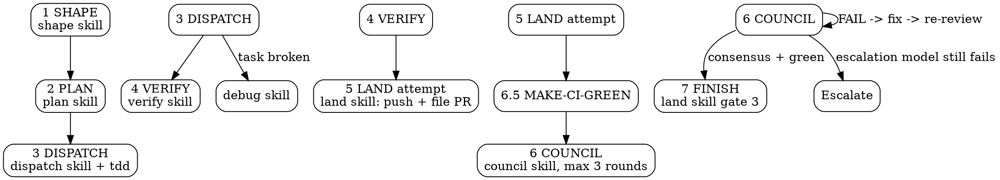

# Oneshot Pipeline

Autonomous end-to-end SDLC: task -> spec -> plan -> implementation -> verification -> PR -> CI watch -> council consensus -> land.

**Core principle:** Full autonomy once started. No pauses between phases. User consulted only at design approval (Gate 1), plan approval (Gate 2), and the final branch decision (Gate 3).

**Auto-approve bypass:** If the initial task description explicitly asks for it ("auto-approve", "skip all approvals", "no approval gates", "full autonomy no questions"), skip all 3 gates. Shape writes `auto-approve: true` plus the quoted trigger phrase on the same header line of the spec BEFORE committing it; oneshot verifies that header line is present and never edits the spec after shape commits it. User instruction at start overrides default gates. Later turns never override it.

**Auto-approve propagation:** when `auto-approve: true` is recorded, the flag travels into the shape and plan dispatch prompts, and those skills must suppress their own approval waits.

**Announce at start:** "Oneshot pipeline starting for: [task description]"

**Visibility:** The whole pipeline runs in the main session. Announce every phase transition. Stream every subagent result back into main as it returns.

**Context hygiene:** Main orchestrates. Main never writes implementation code inline. Per-task and per-round work is dispatched to fresh subagents through the AGENTS.md Dispatch Adapter. Never delegate a whole phase or the whole pipeline to one subagent.

**Model routing:** Skills never hardcode models. Role rows, optional `## Quota pools`, and optional `## Backup ladder` live in the active provider profile (`PROVIDERS.md`); the `HARNESS.md` (`AGENTS.md`) Routing Rules (quota pools & ledger `<dest>/state/quota-ledger.tsv`, failure classes, soft cap & reserve, backup ladder walk, and budget stop & resume) and Dispatch Adapter govern how a role becomes a running subagent. On a usage-limit or 429-style provider error (`exhausted`, written to the quota ledger), an `unreachable` rung, a failed `transient` retry, or a soft-cap reserved pool, re-dispatch the same role on the next eligible rung of its ladder (followed by sibling implementation hand-off and `## Backup ladder`), announce it (`backup: <role> -> <provider>/<model>` on backup rungs), or stop with `budget stop: <role>` when no eligible rung remains. Routing-file note: the installed copy of the harness rules is `HARNESS.md`; `<dest>/AGENTS.md` is the user's own file and is never overwritten.

## Step 0: Routing Bootstrap

<HARD-GATE>
Before entering Phase 1 or spawning ANY subagent, complete all three bootstrap checks:
1. **Load `HARNESS.md` and `PROVIDERS.md` into context:** Verify that `# Cybernetic SDLC Harness` (`HARNESS.md`) AND the active provider profile routing table (`PROVIDERS.md`) are BOTH already loaded verbatim in this session. If either is missing, read `../_harness/HARNESS.md` and `../_harness/PROVIDERS.md` (or `../../HARNESS.md` and `../../PROVIDERS.md`) relative to this skill's directory NOW before taking any other action (quota ledger read/updated via shell at `../../state/quota-ledger.tsv`).
2. **Select the `HARNESS.md` Dispatch Adapter path (including lazy MCP servers):** Inspect both eager tools and any lazy-loaded MCP server schemas in your environment before choosing a subagent tool. Run the one-time session capability check required by `HARNESS.md` `## Dispatch Adapter` Path 1 when cross-provider orchestration tools are present (reading their lazy MCP schema files first when needed), and NEVER fall back to native same-session subagent tools while Path 1 orchestration tools are available. Hold the active Dispatch Adapter path and resolved primary rungs in session memory until Phase 1 step 1 activates the feature branch or worktree.
3. **Forbid same-model inheritance:** Every subagent (`scout`, `tester`, `implementer`, `implementer-deep`, `patch`, `task-reviewer`, `design`, `reviewer-a`, `reviewer-b`, `reviewer-c`, `reviewer-esc`) MUST resolve its exact `<provider>/<model> (<effort>)` rung from `PROVIDERS.md` per `HARNESS.md` `## Dispatch Adapter`: seat dispatches (`scout`, `tester`, `implementer`, `implementer-deep`, `patch`, `reviewer-*`) carry `Role contract:` + `Rung:` (or `Rung:` only on autoloaded pinned seats), while `task-reviewer` and `design` carry `Rung:` only (no `Role contract:`, as they have no agent file). Spawning native `inherit`/same-model subagents across roles when `PROVIDERS.md` routes those roles to distinct providers or models is a hard protocol violation.
</HARD-GATE>

## Pipeline Overview



Run phases sequentially 1 -> 7 in the main session. No skipping. Validate the prior phase artifact exists before entering the next phase. When a step says to invoke a skill via the `skill` tool and the current host has no `skill` tool, read `../<skill>/SKILL.md` relative to this skill's directory instead.

---

## Phase 1: SHAPE

**Skill:** `shape`
**Output:** `docs/specs/YYYY-MM-DD-<topic>-design.md` (spec)

1. Ensure the working directory (main checkout or git worktree) is on a feature branch (e.g. `feat/<topic>`). If the tree sits on the default branch (`master`/`main`), either switch to a new `feat/<topic>` branch or create and move into a feature worktree (use the host's worktree tool when available, or a linked git worktree). When already inside a dedicated feature worktree/branch, reuse its branch. Once the feature branch or worktree is active, run `mkdir -p "$(git rev-parse --git-dir)/info"` and record the active Dispatch Adapter path and resolved primary rungs in `$(git rev-parse --git-dir)/info/oneshot-state.md`. This is the FIRST step, before the shape skill runs: shape writes and commits the spec, so the feature branch must be active before it runs. All pipeline commits after this point happen on a feature branch.
2. Invoke the `shape` skill via the `skill` tool (or read `../shape/SKILL.md`). Follow its Socratic design checklist: purpose, constraints, success criteria, 2-3 approaches with trade-offs, user-approved design. Any codebase search touching >1 file or 50+ lines dispatches `scout` through the `HARNESS.md` Dispatch Adapter (`HARNESS.md` Context Hygiene). Shape invokes `domain-modeling` when the design introduces or renames domain concepts, and `codebase-design` when it changes a module interface. The shape skill writes and commits the spec onto that branch.
3. The spec commit is owned by shape (step 2). Oneshot only verifies the spec artifact exists at `docs/specs/YYYY-MM-DD-<topic>-design.md` and proceeds. Do not run `git add` or `git commit` here.
4. Gate 1: user approves the design (skip under bypass; verify the `auto-approve: true` header line shape wrote before committing, do not edit the spec here). One owner for plan handoff: shape returns control to the controller at the end of Phase 1, and the controller will invoke plan exactly once in Phase 2. Shape never invokes plan when running under oneshot, and plan is invoked only by the controller.

---

## Phase 2: PLAN

**Skill:** `plan`
**Output:** `docs/plans/YYYY-MM-DD-<feature>.md` (implementation plan)

1. At the end of Phase 1, shape returns control to the controller, and oneshot will invoke plan exactly once in Phase 2 (shape never invokes plan when running under oneshot, and plan is invoked only by the controller). Invoke the `plan` skill via the `skill` tool (or read `../plan/SKILL.md`). Decompose the spec into bite-size tasks with exact file paths, commands, and commit points. No placeholders.
2. Save to `docs/plans/YYYY-MM-DD-<feature>.md`. Shape owns the spec commit, oneshot owns the plan commit. Commit the plan with this explicit form:
```
if ! git check-ignore -q docs/plans/YYYY-MM-DD-<feature>.md; then
  git add docs/plans/YYYY-MM-DD-<feature>.md
  git commit -m "docs: plan for [topic]"
fi
```
If the path IS ignored, record the local path and never use `git add -f`.
3. Gate 2: user approves the plan (skip under bypass).
4. Execution mode is subagent-driven only. Do not offer inline execution.

---

## Phase 3: DISPATCH

**Skills:** `dispatch` + `tdd`
**Error routing:** `debug`

1. Invoke `dispatch` and `tdd` via the `skill` tool (or read `../dispatch/SKILL.md` and `../tdd/SKILL.md`).
2. Work on the active feature branch (in the current checkout or dedicated worktree from Phase 1). Clean `git status` first; create the feature branch or worktree here only if Phase 1 was skipped (e.g. resume into Phase 3).
3. For each plan task with behaviour to test, dispatch `tester` first through the `HARNESS.md` Dispatch Adapter with the red-step brief from `dispatch/tester-prompt.md` (writes failing tests in the working tree, runs them to confirm the failure reason, never writes production code, never commits). Then dispatch `implementer` (or `implementer-deep` for tasks flagged complex) through the `HARNESS.md` Dispatch Adapter with the task brief from `dispatch/implementer-prompt.md` and the `tester`'s report: `implementer` starts from the `tester`-written red tests, writes the minimal implementation to turn them green, refactors, runs the suite, and commits tests + implementation together (unless Parallel mode: stage only, main commits serially). Mechanical tasks with no new behaviour to test skip `tester` and dispatch `implementer` directly. After each task commit, run both per-task `task-reviewer` stages through the `HARNESS.md` Dispatch Adapter - Stage 1 spec compliance (`dispatch/spec-reviewer-prompt.md`), then Stage 2 code quality (`dispatch/quality-reviewer-prompt.md`), skipping any `task-reviewer` rung whose family authored the task or `tester` red tests (`HARNESS.md` author independence) - and after all tasks complete, run the final `task-reviewer` review before exiting Phase 3. When a GLOSSARY.md exists, the task brief carries the name of any glossary term the task must honor. Seat models and effort levels come from the active provider profile (routed by the `HARNESS.md` Dispatch Adapter); fallback rungs live in the profile's role ladders.
4. Independent tasks run in parallel as separate fresh `implementer` subagent instances (parallel fan-out lives inside `dispatch`).
5. Stream task results to the user as they return (task name, pass/fail, key outputs).
6. Task failure routes to `debug`: root cause first, then re-dispatch (escalating to `implementer-deep` when a bug resists standard fixes). Unfixable after the debug loop: escalate to user with failure context.
7. Record the author model and family per task: after each task commit, append the commit sha, task, and the implementing rung's `<provider>/<model>` and `family` (plus the `tester` rung's `<provider>/<model>` and `family` when `tester`-written tests are committed in that commit; `provider`, `model`, and `family` columns of the active provider profile) to the author commit log in `$(git rev-parse --git-dir)/info/oneshot-state.md`, and update `author_models:` and `author_families:` in that state artifact. In parallel mode the driver commits staged child work serially; record the child's rung `<provider>/<model>` and family, not the driver's. Driver commits of spec, plan, or docs-only state record nothing (AGENTS.md Council Contract).

Fix-loop caps: at most 3 implementer fix attempts per task, then route to `debug`. Debug gets at most 2 rotations; past that, STOP and escalate to the user with context. Escalation after exhausting caps is an explicit allowed stop point - the no-pause rule never overrides budget exhaustion.

---

## Phase 4: VERIFY

**Skill:** `verify`

1. Invoke `verify` via the `skill` tool.
2. Dispatch `tester` as a script runner through the AGENTS.md Dispatch Adapter to run the test suite, lint, typecheck, build, and project scripts (if no suite exists, run what the project docs define and note it), and act on its compressed pass/fail report (failing test/check names and first-error excerpts, never full raw logs in the main session).
3. Cross-check implementation against the spec checklist.
4. Fix failures or route to `debug`. Never proceed on failures.

---

## Phase 5: LAND - push and file the PR

**Skill:** `land`

1. Invoke `land` via the `skill` tool.
2. Push the feature branch, create the PR: body leads with the problem, not the change inventory (`## Summary`, `## Changes`, `## Test plan`, `## Budget`). The `## Budget` block reports pools hit, demotions, backup rungs used, and any degraded seats (updated again in Phase 7 if CI or council rounds trigger further budget events). Reference local spec/plan paths when they are gitignored.
3. Save the PR URL.

---

## Phase 6.5: MAKE-CI-GREEN

**Skill:** `make-ci-green`

1. Invoke `make-ci-green` via the `skill` tool (skip if the repo has no CI/review bots; say "no CI to babysit" and move on).
2. Watch checks and bot reviews. Failing check logs and local reruns are inspected via `tester` (script runner, compressed failure report). Real finding -> fresh fixer subagent (`implementer`, or `implementer-deep` for hard clusters) -> rerun CI (record the fixer rung's `<provider>/<model>` and family per commit in the author commit log and update `author_models:` and `author_families:` in the state artifact, as in Phase 3). No new information -> no rerun. No blind loops, no flake chasing.

---

## Phase 6: COUNCIL (consensus, max 3 rounds)

**Skills:** `council`
**Gate to Phase 7:** consensus PASS (`mode=nominal` >= 2/3, `mode=degraded` unanimous 2/2, or post-round-3 `mode=escalation` single `reviewer-esc` PASS with zero unresolved confirmed red findings and non-author family) **AND** tests green. Both required. The author-model skip (`reviewer-*` skips any rung matching `author_models:`, announcing `demote: <seat> -> <provider>/<model> (author model conflict)`) and author-family PASS rule apply as well (AGENTS.md Routing Rules and Council Contract): the state artifact holds `author_models:` and `author_families:` recorded per commit since Phase 3.

1. Invoke `council` via the `skill` tool.
2. Dispatch three fresh reviewer subagents on three independent model families (`reviewer-a`, `reviewer-b`, `reviewer-c` roles, rungs from the active provider profile, skipping any rung whose model matches `author_models:` in `$(git rev-parse --git-dir)/info/oneshot-state.md`). Each assumes the code is broken, hunts for bugs: spec compliance, edges, error handling, security, diff-vs-plan, regressions.
3. Findings merge into one line per item: `path:line: emoji severity: problem. fix.`
4. Round loop (max 3 rounds, never stops mid-loop):
   - FAIL -> record `council_verdict: FAIL round=<n> mode=<nominal|degraded> head=<sha>` (where `<sha>` is `git rev-parse HEAD`) in `$(git rev-parse --git-dir)/info/oneshot-state.md` -> dispatch fresh implementation-seat fixer subagents (`implementer`, or `implementer-deep` for hard clusters, one per problem cluster, max 2 files each; see `AGENTS.md` Review contracts for fixer seat routing; record each fixer commit's rung `<provider>/<model>` and family and update `author_models:` and `author_families:` in the state artifact) -> push -> re-review next round.
   - PASS + green (after satisfying step 6 author-family vote and CI freshness below on final HEAD) -> record `council_verdict: PASS round=<n> mode=<nominal|degraded> head=<sha>` (where `<sha>` is `git rev-parse HEAD`) to `$(git rev-parse --git-dir)/info/oneshot-state.md`, break, proceed to Phase 7.
   - CI freshness gate: if any council fix round pushed commits after the last green `make-ci-green` receipt, re-enter Phase 6.5 on the final HEAD before Phase 7. A stale green receipt never satisfies the gate.
   - If that 6.5 re-entry itself pushes further CI-repair commits, the final HEAD needs one delta council round on the changed files (counted against the 3-round budget, updating `council_verdict` for the new `HEAD` `<sha>`). If CI repairs occur after round 3 and no council rounds remain: route the green repaired `HEAD` through the single escalation review in step 5 (if escalation is not yet spent), or STOP and escalate to the user when escalation is already spent or CI stays red - never land unreviewed commits.
5. Rounds exhausted -> one escalation review on the `reviewer-esc` rung of the active provider profile (non-author family, unused by council seats, model not in `author_models:`) -> if escalation reviewer passes with zero unresolved confirmed red findings and green tests (and fresh green CI on final `HEAD`; if subsequent CI repairs advance `HEAD` after escalation is spent, STOP and escalate to user), write `council_verdict: PASS round=esc mode=escalation head=<sha>` to `$(git rev-parse --git-dir)/info/oneshot-state.md` and proceed to Phase 7; if escalation fails -> record `council_verdict: FAIL round=esc mode=escalation head=<sha>`, STOP, and escalate to user with round count, findings, test output. Do not proceed.
6. Author-family/model vote & non-blocking rule: before declaring PASS in nominal or degraded mode, verify the council non-blocking rule: Council shall not block if there are at least two different members who can review and are not the same model as the implementer. Check that at least one PASS comes from a non-author family or model distinct from `author_models:`. If all active seats share an author family, accept model-level independence (each seat's reviewer model distinct from `author_models:`) and record in state: `degraded council author vote: model-level independence (<model1>, <model2>)`; only if fewer than 2 distinct non-author models can review does council stop with `yellow: degraded council`.
7. No test suite: see `AGENTS.md` Review contracts for the `no-tests` gate rule (`mode=nominal` only; `mode=degraded` and `mode=escalation` require green tests). Label a `no-tests` PASS `provisional: no-tests` in the verdict, and have the reviewer flag `no tests` as yellow. Record any `no-tests decision: proceed` in the state artifact; for a standalone council run the state artifact is `$(git rev-parse --git-dir)/info/oneshot-state.md` in the target repo or worktree, created if missing (`mkdir -p "$(git rev-parse --git-dir)/info"`).

**Rules:** Reviewer never fixes, fixer never reviews. Fresh subagents every round. Rounds 1-2 never pause for user input; stream results in passing. Verify every finding against real code before acting.

---

## Phase 7: FINISH

**Skill:** `land` (Gate 3)

1. Verify tests pass on final state (or satisfy the `no-tests` gate rule in `AGENTS.md` Review contracts for `mode=nominal`) AND verify Phase 6 Council consensus PASS is recorded on the effective last `council_verdict` line in `$(git rev-parse --git-dir)/info/oneshot-state.md` (`council_verdict: PASS round=<n> mode=<nominal|degraded|escalation> head=<sha>`, where `<n>` is `1..3` or `esc`) with `mode` in `nominal|degraded|escalation` and `head=<sha>` matching both local `git rev-parse HEAD` and remote PR head (`gh pr merge --squash --match-head-commit <sha>`). Land checks the effective last `council_verdict` line in state; never merge or land without verified Council consensus PASS on the current HEAD.
2. Refresh the PR body's `## Budget` block and include a **Budget** summary block in the final report (pools hit, demotions, backup rungs used, and any degraded seats; `AGENTS.md` Routing Rules, budget stop & resume). Landed options: merge PR and clean up, keep PR open, keep branch, discard. Present options (skip under bypass: default keep PR open).
3. `land` executes the user choice. It reuses the standard flow: create-PR-if-none, merge open PR, checkout default, pull (the "next feature" handoff).
4. Record it with the memory tool: mode "add", content "oneshot completed: [task] on [branch]". Remove the state artifact at the end of the run.

---

## State Artifact

Once the feature branch or worktree is active (Phase 1 step 1, or Phase 3 step 2 when resuming directly into Phase 3), and at every phase transition or budget event thereafter, run `mkdir -p "$(git rev-parse --git-dir)/info"` (so both standard checkouts where `.git` is a directory and linked git worktrees where `.git` is a file work cleanly) and record or update `$(git rev-parse --git-dir)/info/oneshot-state.md` (append or rewrite in place): active Dispatch Adapter path, resolved primary rungs, phase, branch, PR URL, `author_models:` (deduplicated authoring `model` IDs), `author_families:` (deduplicated authoring `family` IDs), author commit log (`<sha> <task> <provider>/<model> <family>`), tests status, council round count, `council_verdict: PASS|FAIL round=<n> mode=<nominal|degraded|escalation> head=<sha>` (where `<n>` is `1..3` or `esc`, `head=<sha>` must match `git rev-parse HEAD`, and consumers evaluate the effective last `council_verdict` line), standing red findings (one line each), `soft_cap_counts` (per-pool dispatch counts in this pipeline run for soft-cap enforcement), and `earliest_resume` (earliest reset timestamp across exhausted pools when stopped on `budget stop: <role>`). On interrupt or after a budget stop, resume from the state artifact plus `<dest>/state/quota-ledger.tsv`, the spec, and the plan; the state file is the truth for round counters, `council_verdict`, `author_models:`, `author_families:`, `soft_cap_counts`, `earliest_resume`, and standing findings - never re-open a closed round or re-spend a burnt budget. `$(git rev-parse --git-dir)/info/oneshot-state.md` is the only per-run state location: it is machine-local and worktree-local, never committed, never `git add -f`'d, and removed at the end of Phase 7.

## Error Handling

| Symptom | Route | Action |
| --- | --- | --- |
| Task fails during execution | debug | Root cause, fix, retry |
| Unfixable bug | User | Report phase + error + context |
| Council FAIL (rounds 1-2) | council loop | Fix -> re-review automatically |
| Council FAIL (round 3+ or escalation fails) | User | Stop, present findings + test output |
| Spec incomplete | Phase 1 | Fix gaps, re-approve |
| Plan has gaps | Phase 2 | Add missing tasks |
| Model / pool exhausted or soft-capped | Active provider profile ladder + `## Backup ladder` (`AGENTS.md` Routing Rules) | Record pool in `quota-ledger.tsv` on exhaustion, demote or walk backup ladder (`backup: <role> -> <provider>/<model>`), announce, continue; if no rung left, report `budget stop: <role>` with `earliest_resume` |
| User interrupts | Resume | Restart from state artifact + spec + plan |

## Red Flags - Never

- Skip a phase; proceed without loading the phase skills
- Proceed past Gate 1/2 without approval (unless bypass at start)
- Merge without verification; continue past failures
- Pause, ask, or present options mid-loop after a FAIL round (1-2 in council, all rounds in task loop)
- Delegate the whole pipeline or a whole phase to one subagent
- Run silently: no transition announcements, no streamed results
- Hardcode a model ID; route by role through the active provider profile and AGENTS.md routing rules
- Run the council on 1 healthy reviewer and call it consensus
- `git add -f` a gitignored path
- Exceed caps: 3 council rounds, silence after escalation

## Key Principles

- **Gated autonomy:** 3 gates only, everything between runs without stopping
- **Artifact-based resume:** state artifact + spec + plan on disk are the truth for resume
- **Context-clean:** implementation only via fresh per-task subagents
- **Visible:** every phase change and subagent result announced in main
- **TDD always:** failing test before production code, per task
- **Consensus over single gatekeeper:** council, independent families, honest degradation
- **Model-agnostic skills:** routing rules live only in AGENTS.md and the model table only in the provider profile
