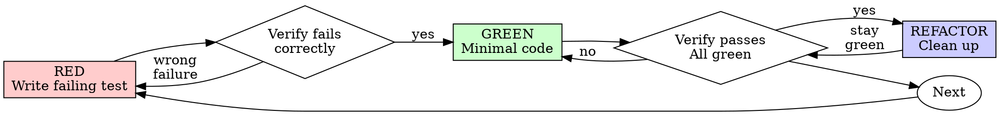

# Test-Driven Development (TDD)

## Overview

Write the test first. Watch it fail. Write minimal code to pass.

**Core principle:** If you didn't watch the test fail, you don't know whether it tests the right thing.

**Violating the letter of the rules is violating the spirit of the rules.**

## When to Use

**Always:**
- New features
- Bug fixes
- Refactoring
- Behavior changes

**Exceptions (ask your human partner):**
- Throwaway prototypes
- Generated code
- Configuration files

Thinking "skip TDD just this once"? Stop. That's rationalization.

## The Iron Law

```
NO PRODUCTION CODE WITHOUT A FAILING TEST FIRST
```

Wrote code before the test? Delete it. Start over.

**No exceptions:**
- Don't keep it as "reference"
- Don't "adapt" it while writing tests
- Don't look at it
- Delete means delete

Implement fresh from the tests. Period.

## Red-Green-Refactor



**Seat split under `dispatch`:** for a plan task with behaviour to test, `dispatch` runs the **RED** step on the `tester` seat (`dispatch/tester-prompt.md` - writes failing tests, confirms they fail for the right reason, never writes production code, leaves tests uncommitted in the working tree) and then dispatches `implementer` (`dispatch/implementer-prompt.md`) with the `tester`'s report to run **GREEN** and **REFACTOR** and commit tests + implementation together (`implementer` may add tests, and never weakens or deletes `tester`-written tests without a stated reason in its report). When `implementer` runs without `tester` (mechanical tasks or standalone runs), `implementer` executes the full RED -> GREEN -> REFACTOR cycle itself.

### RED - Write Failing Test

Write one minimal test showing what should happen.

<Good>
```typescript
test('retries failed operations 3 times', async () => {
  let attempts = 0;
  const operation = () => {
    attempts++;
    if (attempts < 3) throw new Error('fail');
    return 'success';
  };

  const result = await retryOperation(operation);

  expect(result).toBe('success');
  expect(attempts).toBe(3);
});
```
Clear name, tests real behavior, one thing
</Good>

<Bad>
```typescript
test('retry works', async () => {
  const mock = jest.fn()
    .mockRejectedValueOnce(new Error())
    .mockRejectedValueOnce(new Error())
    .mockResolvedValueOnce('success');
  await retryOperation(mock);
  expect(mock).toHaveBeenCalledTimes(3);
});
```
Vague name, tests mock not code
</Bad>

**Requirements:**
- One behavior
- Clear name
- Real code (no mocks unless unavoidable)

### Verify RED - Watch It Fail

**MANDATORY. Never skip.**

```bash
npm test path/to/test.test.ts
```

Confirm:
- Test fails (not errors)
- Failure message is expected
- Fails because the feature is missing (not typos)

**Test passes?** You're testing existing behavior. Fix the test.

**Test errors?** Fix the error, re-run until it fails correctly.

### GREEN - Minimal Code

Write the simplest code to pass the test.

<Good>
```typescript
async function retryOperation<T>(fn: () => Promise<T>): Promise<T> {
  for (let i = 0; i < 3; i++) {
    try {
      return await fn();
    } catch (e) {
      if (i === 2) throw e;
    }
  }
  throw new Error('unreachable');
}
```
Just enough to pass
</Good>

<Bad>
```typescript
async function retryOperation<T>(
  fn: () => Promise<T>,
  options?: {
    maxRetries?: number;
    backoff?: 'linear' | 'exponential';
    onRetry?: (attempt: number) => void;
  }
): Promise<T> {
  // YAGNI
}
```
Over-engineered
</Bad>

Don't add features, refactor other code, or "improve" beyond the test.

### Verify GREEN - Watch It Pass

**MANDATORY.**

```bash
npm test path/to/test.test.ts
```

Confirm:
- Test passes
- Other tests still pass
- Output shows no NEW errors or warnings introduced by this change

**Test fails?** Fix code, not test.

**Other tests fail?** Fix now.

### REFACTOR - Clean Up

After green only:
- Remove duplication
- Improve names
- Extract helpers

Keep tests green. Don't add behavior.

### Repeat

Next failing test for the next feature.

## Good Tests

| Quality | Good | Bad |
|---------|------|-----|
| **Minimal** | One thing. "and" in name? Split it. | `test('validates email and domain and whitespace')` |
| **Clear** | Name describes behavior | `test('test1')` |
| **Shows intent** | Demonstrates desired API | Obscures what code should do |

## Why Order Matters

**"I'll write tests after to verify it works"**

Tests written after code pass immediately. Passing immediately proves nothing:
- Might test the wrong thing
- Might test implementation, not behavior
- Might miss edge cases you forgot
- You never saw it catch the bug

Test-first forces you to see the test fail, proving it actually tests something.

**"I already manually tested all the edge cases"**

Manual testing is ad-hoc. You think you tested everything, but:
- No record of what was tested
- Can't re-run when code changes
- Easy to forget cases under pressure
- "It worked when I tried it" is not comprehensive

Automated tests are systematic. They run the same way every time.

**"Deleting X hours of work is wasteful"**

Sunk cost fallacy. The time is already gone. The choice now:
- Delete and rewrite with TDD (X more hours, high confidence)
- Keep it and add tests after (30 min, low confidence, likely bugs)

The "waste" is keeping code you can't trust. Working code without real tests is technical debt.

**"TDD is dogmatic, being pragmatic means adapting"**

TDD IS pragmatic:
- Finds bugs before commit (faster than debugging after)
- Prevents regressions (tests catch breaks immediately)
- Documents behavior (tests show how to use code)
- Enables refactoring (change freely, tests catch breaks)

"Pragmatic" shortcuts equal debugging in production, which is slower.

**"Tests after achieve the same goals - it's spirit not ritual"**

No. Tests-after answer "What does this do?" Tests-first answer "What should this do?"

Tests-after are biased by the implementation. You test what you built, not what's required. You verify remembered edge cases, not discovered ones.

Tests-first force edge case discovery before implementing. Tests-after verify you remembered everything (you didn't).

30 minutes of tests after is not TDD. You get coverage, lose proof the tests work.

## Common Rationalizations

| Excuse | Reality |
|--------|---------|
| "Too simple to test" | Simple code breaks. Test takes 30 seconds. |
| "I'll test after" | Tests passing immediately prove nothing. |
| "Tests after achieve same goals" | Tests-after = "what does this do?" Tests-first = "what should this do?" |
| "Already manually tested" | Ad-hoc is not systematic. No record, can't re-run. |
| "Deleting X hours is wasteful" | Sunk cost fallacy. Keeping unverified code is technical debt. |
| "Keep as reference, write tests first" | You'll adapt it. That's testing after. Delete means delete. |
| "Need to explore first" | Fine. Throw away the exploration, start with TDD. |
| "Test hard = design unclear" | Listen to the test. Hard to test = hard to use. |
| "TDD will slow me down" | TDD is faster than debugging. Pragmatic = test-first. |
| "Manual test faster" | Manual doesn't prove edge cases. You'll re-test every change. |
| "Existing code has no tests" | You're improving it. Add tests for existing code. |

## Red Flags - STOP and Start Over

- Code before test
- Test after implementation
- Test passes immediately
- Can't explain why the test failed
- Tests added "later"
- Rationalizing "just this once"
- "I already manually tested it"
- "Tests after achieve the same purpose"
- "It's about spirit not ritual"
- "Keep as reference" or "adapt existing code"
- "Already spent X hours, deleting is wasteful"
- "TDD is dogmatic, I'm being pragmatic"
- "This is different because..."

**All of these mean: delete the code. Start over with TDD.**

## Example: Bug Fix

**Bug:** Empty email accepted

**RED**
```typescript
test('rejects empty email', async () => {
  const result = await submitForm({ email: '' });
  expect(result.error).toBe('Email required');
});
```

**Verify RED**
```bash
$ npm test
FAIL: expected 'Email required', got undefined
```

**GREEN**
```typescript
function submitForm(data: FormData) {
  if (!data.email?.trim()) {
    return { error: 'Email required' };
  }
  // ...
}
```

**Verify GREEN**
```bash
$ npm test
PASS
```

**REFACTOR**
Extract validation for multiple fields if needed.

## Verification Checklist

Before marking work complete:

- [ ] Every new function/method has a test
- [ ] Watched each test fail before implementing
- [ ] Each test failed for the expected reason (feature missing, not typo)
- [ ] Wrote minimal code to pass each test
- [ ] All tests pass
- [ ] Output shows no NEW errors or warnings introduced by this change
- [ ] Tests use real code (mocks only if unavoidable)
- [ ] Edge cases and errors covered

Can't check all boxes? You skipped TDD. Start over.

## When Stuck

| Problem | Solution |
|---------|----------|
| Don't know how to test | Write the wished-for API. Write the assertion first. Ask your human partner. |
| Test too complicated | Design too complicated. Simplify the interface. |
| Must mock everything | Code too coupled. Use dependency injection. |
| Test setup huge | Extract helpers. Still complex? Simplify the design. |

## Debugging Integration

Bug found? Write a failing test reproducing it, then follow the cycle. The test proves the fix and blocks regression. If the fix isn't quick because the cause is unknown, invoke the debug skill via the skill tool BEFORE proposing fixes. Never fix bugs without a test.

## Mock Discipline

Tests must verify real behavior, not mock behavior. Mocks exist to isolate, not to be the thing tested. Applying this cycle prevents the worst failures.

```
1. NEVER test mock behavior
2. NEVER add test-only methods to production classes
3. NEVER mock without understanding dependencies
```

**Anti-pattern: testing mock behavior.** An assertion on a mock element proves the mock exists, not that the code works.

```typescript
// BAD: verifying the mock
expect(screen.getByTestId('sidebar-mock')).toBeInTheDocument();

// GOOD: test real behavior, or unmock it
expect(screen.getByRole('navigation')).toBeInTheDocument();
```

Gate: before asserting on any mock, ask "am I testing real behavior or mock existence?" Mock existence: STOP, unmock or reroute the test.

**Anti-pattern: test-only methods in production classes.** `Session.destroy()` used only from `afterEach` pollutes production code and confuses lifecycles. Gate: any method used only by tests belongs in test utilities, and any method that doesn't belong to this class belongs nowhere.

```typescript
// GOOD: cleanup lives in test utilities
export async function cleanupSession(session: Session) { /* ... */ }
afterEach(() => cleanupSession(session));
```

**Anti-pattern: mocking without understanding.** A mock that drops a side effect the test depends on makes the test pass for the wrong reason.

```typescript
// BAD: this method also writes config the test relies on
vi.mock('ToolCatalog', () => ({ discoverAndCacheTools: vi.fn().mockResolvedValue(undefined) }));
```

Gate: before mocking, ask what side effects the real method has, whether the test depends on them, and what this test actually needs. Depends on side effects: mock lower (the slow or external operation), not the high-level method. Unsure: run it against the real implementation first, then mock minimally at the right level. "I'll mock it to be safe" is a red flag.

**Anti-pattern: incomplete mocks.** Mock the COMPLETE data structure as it exists in reality, not just the fields this test touches. Partial mocks hide structural assumptions, fail silently downstream, and give false confidence.

```typescript
// BAD: missing fields downstream code consumes (response.metadata.requestId)
const mockResponse = { status: 'success', data: { userId: '123', name: 'Alice' } };

// GOOD: mirror the real response schema
const mockResponse = {
  status: 'success',
  data: { userId: '123', name: 'Alice' },
  metadata: { requestId: 'req-789', timestamp: 1234567890 },
};
```

**Mock setup longer than the test, tests failing only when a mock changes, or mocking "just to be safe":** step back. Integration tests with real components are often simpler than complex mocks.

| Anti-Pattern | Fix |
|--------------|-----|
| Asserting on mock elements | Test real behavior or unmock |
| Test-only methods in production | Move to test utilities |
| Mock without understanding | Understand dependencies first, mock minimally |
| Incomplete mocks | Mirror the real API completely |
| Mock setup > half the test | Consider integration tests with real components |

## Final Rule

```
Production code -> test exists and failed first
Otherwise -> not TDD
```

No exceptions without your human partner's permission.
