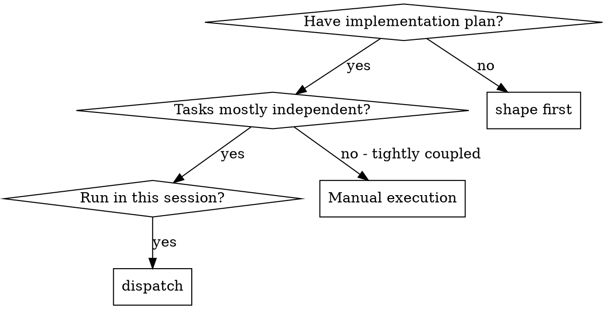
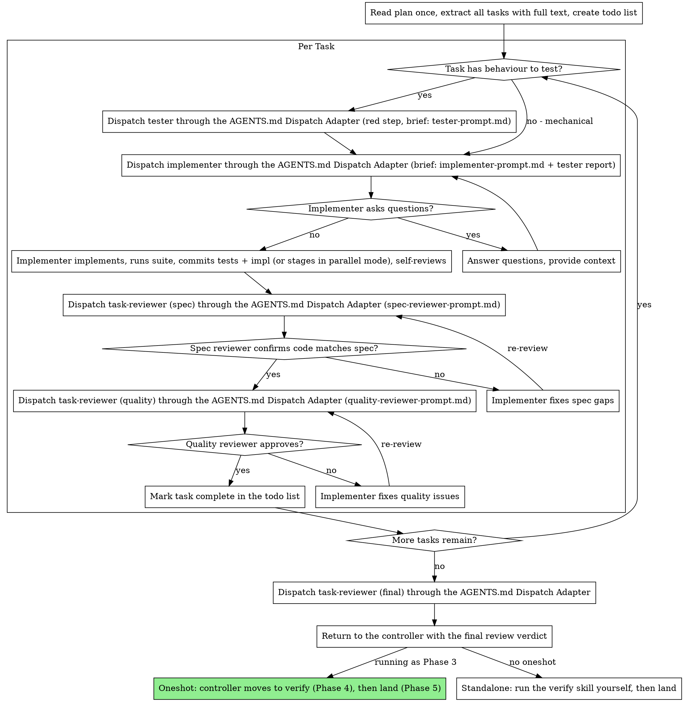
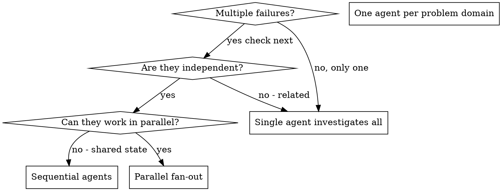

# Dispatch

Execute a plan by dispatching a fresh subagent per task, with two-stage review after each: spec compliance review first, then code quality review.

**Why subagents:** delegate tasks to agents with isolated context. By precisely crafting their instructions and context, they stay focused and succeed at their task. They never inherit this session's context or history: construct exactly what they need. This also preserves the main session's context for coordination work.

**Core principle:** fresh subagent per task + two-stage review (spec then quality) = high quality, fast iteration.

**Continuous execution:** do not pause to check in with the user between tasks. Execute all tasks from the plan without stopping. The only reasons to stop: BLOCKED status that cannot be resolved, ambiguity that genuinely prevents progress, or all tasks complete. "Should I continue?" prompts and progress summaries waste the user's time. They asked for the plan to run, so run it.

**Oneshot is the hub:** this skill is Phase 3 of the oneshot pipeline. Never delegate a whole plan or the whole pipeline to one subagent. Executing a plan always happens here; the main session orchestrates, subagents execute.

## When to Use



**vs manual execution:**
- Fresh subagent per task, no context pollution
- Two-stage review after each task: spec compliance first, then code quality
- Faster iteration, no human-in-loop between tasks
- Subagents can ask questions before and during work

## Working Branch & Worktrees

Work on a feature branch from a clean tree - either in the current checkout or inside a dedicated git worktree (created with the host's worktree tool, e.g. OpenCode `tools.opencode.worktree_create` + `session_move`, or a T3 Code worktree thread). If the working tree is on `master` or `main`, create a feature branch or worktree before dispatching. Never develop on `master` or `main` without explicit user consent; `master`/`main` advances only via PR merge (the `land` skill handles that).

## The Process



Final handoff: return to the controller with the final review verdict. Inside the oneshot pipeline, the controller moves to verify (Phase 4) and then land (Phase 5). Do not call land from inside dispatch when running as Phase 3 - oneshot owns the phase ordering.

Standalone (no oneshot): after final review PASS, run the verify skill yourself, then land.

## Model Routing

Skills never hardcode model IDs. Route every subagent by role through the active provider profile (`PROVIDERS.md`) and the AGENTS.md Routing Rules, dispatching through the AGENTS.md Dispatch Adapter (which chooses the native or `delegate_task` path per rung). Every dispatch names a rung so nothing inherits the main session model by accident.

**Testing and implementation seats** (models and effort levels per the active provider profile; native pin rendered at install):
- `tester` - the red-step test author and script runner (rungs from the active provider profile). For any plan task with behaviour to test, dispatch `tester` first (`tester-prompt.md`) to write the failing tests, run them, confirm they fail for the right reason, and leave them uncommitted in the working tree.
- `implementer` - the default implementation seat (rungs from the active provider profile). Dispatched after `tester` with the `tester`'s report (`implementer-prompt.md`) to make the red tests pass, refactor, run the suite, and commit `tester` tests + implementation together; for mechanical tasks with no new behaviour to test, dispatch `implementer` directly (skip `tester`). Parallel fan-out dispatches several `implementer` instances concurrently.
- `implementer-deep` - the heavy-reasoning seat reserved for complex multi-file architecture tasks and difficult bugs escalated by `debug`.

On a usage-limit/429 error (`exhausted`, recorded in `<dest>/state/quota-ledger.tsv`), an `unreachable` rung, a failed `transient` retry, or a soft-cap reserved pool: follow the AGENTS.md Routing Rules (quota pools & ledger, failure classes, soft cap & reserve, and backup ladder walk) to re-dispatch the same role on the next eligible rung of its ladder in the active provider profile, announce the demotion, and continue. An implementation seat (`implementer`, `implementer-deep`) with no reachable ladder rung hands the task to the other implementation seat (`implementer-deep` <-> `implementer`, never revisiting an exhausted seat) before walking `## Backup ladder` (`backup: <role> -> <provider>/<model>`); when no eligible rung remains after the backup ladder, stop and report `budget stop: <role>` with exhausted pools and `earliest resume` per AGENTS.md Routing Rules (budget stop & resume). After each task commit, the controller records the implementing rung's family (and the `tester` rung's family when `tester`-written tests are committed) for the author-family rule (oneshot Phase 3, step 7).

**Stage reviewers dispatch ad-hoc:** spec-reviewer and quality-reviewer subagents are role `task-reviewer` from the active provider profile, chosen after the seat matrix call above; skip any `task-reviewer` rung whose family wrote the code or `tester` red tests for that task (AGENTS.md Routing Rules, author independence). They are not seat agents; fresh context each time, explicit rung each time.

**Seat matrix (route every test/implementation step through a named seat agent; models and effort levels per the active provider profile):**
- Red step for a task with behaviour to test -> `tester` (writes failing tests in the working tree without committing), followed by `implementer` (green + refactor + commit).
- Default single-task or mechanical work, and parallel fan-out (several `implementer` instances) -> `implementer`.
- Multi-file architecture, concurrency, or a bug that resisted one standard attempt -> `implementer-deep`.
- 1-2 file surgical edits with no test run -> `patch`.

Confidential briefs: when a task brief is marked confidential, only the AGENTS.md Routing Rules privacy gate applies (`privacy: trains` rungs in the active provider profile auto-skip); demote straight to the next privacy-safe rung and announce. There is no seat preference for confidential work.

## Handling Implementer Status

Implementer subagents report one of four statuses. Handle each appropriately:

**DONE:** proceed to spec compliance review.

**DONE_WITH_CONCERNS:** the implementer completed the work but flagged doubts. Read the concerns before proceeding. If they concern correctness or scope, address them before review. If they are observations (e.g. "this file is getting large"), note them and proceed to review.

**NEEDS_CONTEXT:** the implementer needs information that was not provided. Provide the missing context and re-dispatch.

**BLOCKED:** the implementer cannot complete the task. Assess the blocker:
1. Context problem: provide more context, re-dispatch with the same rung
2. Task needs more reasoning: re-dispatch on a stronger rung of the ladder
3. Task too large: break it into smaller pieces
4. Plan itself is wrong: escalate to the user

**Never** ignore an escalation or force the same rung to retry without changes. If the implementer said it is stuck, something needs to change.

## Review Stages

Both review stages dispatch fresh reviewer subagents that follow the council review contract. One owner: use the reviewer instruction block from `skills/council/SKILL.md` verbatim for each single reviewer (never invoke the council skill via the skill tool, which would start the full 3-seat branch loop), with the one-line finding format (`path:line: severity: problem. fix.`), and receiving-side rigor (confirm every finding against real code before dispatching fixes).

- **Stage 1, spec compliance:** verify the implementer built what was requested, nothing more, nothing less (and kept any `tester`-written tests intact unless a valid reason was stated in the report).
- **Stage 2, code quality:** verify the implementation is well-built. Order is fixed. Never start quality review before spec compliance passes.

Reviewer never fixes. Fixer never reviews. Fresh reviewer subagent every round.

## Prompt Templates

- `tester-prompt.md` - template: dispatch the `tester` seat agent for the TDD red step (write failing tests only, confirm failure reason, never commit)
- `implementer-prompt.md` - template: dispatch the `implementer` seat agent with the task brief and the `tester`'s red-step report
- `spec-reviewer-prompt.md` - template for dispatching the spec compliance reviewer
- `quality-reviewer-prompt.md` - template for dispatching the code quality reviewer (council format)

## Example Workflow

```
[Announce] Running dispatch on this plan.

[Read plan file once: docs/plans/feature-plan.md]
[Extract all 5 tasks with full text and context]
[Create todo list with all tasks]

Task 1: Hook installation script (has behaviour to test)

[Get Task 1 text and context (already extracted)]
[Dispatch `tester` through the AGENTS.md Dispatch Adapter with the brief from `tester-prompt.md`]
Tester:
  - Status: DONE (mode: red-step)
  - Wrote failing tests in test/install-hook.test.ts (uncommitted in working tree)
  - Command: npm test -- test/install-hook.test.ts
  - Result: 5 failing ("installHook is not a function")

[Dispatch `implementer` through the AGENTS.md Dispatch Adapter with the brief from `implementer-prompt.md` (full task text + `tester` red-step report + context)]

Implementer: "Before I begin - should the hook be installed at user or system level?"

You: "User level (~/.config/opencode/hooks/)"

Implementer: "Got it. Implementing now..."
[Later] Implementer:
  - Started from tester's 5 red tests in test/install-hook.test.ts
  - Implemented install-hook command, 5/5 passing
  - Self-review: found I missed --force flag, added test + implementation
  - Committed tester tests + implementation together (or staged in parallel mode)

[Dispatch `task-reviewer` (spec) through the AGENTS.md Dispatch Adapter]
Spec reviewer: PASS - all requirements met, tester tests intact, nothing extra

[Get git SHAs, dispatch `task-reviewer` (quality) through the AGENTS.md Dispatch Adapter]
Quality reviewer: Strengths: good test coverage, clean. Findings: none. Verdict: PASS.

[Mark Task 1 complete on the feature branch]

Task 2: Recovery modes (has behaviour to test)

[Dispatch `tester` through the AGENTS.md Dispatch Adapter with the brief from `tester-prompt.md`]
Tester:
  - Status: DONE (mode: red-step)
  - Wrote 8 failing tests in test/recovery.test.ts

[Dispatch `implementer` through the AGENTS.md Dispatch Adapter with the brief from `implementer-prompt.md` (full task text + `tester` report + context)]

Implementer: [No questions, proceeds]
Implementer:
  - Added verify/repair modes
  - 8/8 tests passing
  - Self-review: all good
  - Committed tester tests + implementation together (or staged in parallel mode)

[Dispatch `task-reviewer` (spec) through the AGENTS.md Dispatch Adapter]
Spec reviewer: FAIL. Findings:
  - red: missing progress reporting (spec says "report every 100 items")
  - red: extra --json flag added, not requested

[Implementer fixes issues]
Implementer: Removed --json flag, added progress reporting

[Spec reviewer reviews again]
Spec reviewer: PASS

[Dispatch `task-reviewer` (quality) through the AGENTS.md Dispatch Adapter]
Quality reviewer: Strengths: solid. Findings: yellow: magic number (100)

[Implementer fixes]
Implementer: Extracted PROGRESS_INTERVAL constant

[Quality reviewer reviews again]
Quality reviewer: PASS

[Mark Task 2 complete]

...

[After all tasks]
[Dispatch `task-reviewer` (final) through the AGENTS.md Dispatch Adapter for the entire implementation]
Final reviewer: All requirements met, ready to merge

[Return to the controller with the final review verdict]
[Inside oneshot: controller moves to verify (Phase 4), then land (Phase 5). Standalone: run the verify skill yourself, then land]
```

## Parallel Fan-out

The fresh-context rule applies to parallel work too. When multiple unrelated failures appear (different test files, different subsystems, different bugs), sequential investigation wastes time. Each independent piece can happen concurrently.

**Core rule:** one agent per independent problem domain. Let them work concurrently.

### When to Fan Out



**Use when:**
- 3+ test files failing with different root causes
- Multiple subsystems broken independently
- Each problem can be understood without context from the others
- No shared state between investigations

**Don't use when:**
- Failures are related (fixing one might fix the others)
- Need to understand full system state
- Agents would interfere with each other

### The Pattern

**1. Identify independent domains.** Group failures by what is broken:
- File A tests: tool approval flow
- File B tests: batch completion behavior
- File C tests: abort functionality

Each domain is independent: fixing tool approval does not affect abort tests.

**2. Create focused agent tasks.** Each agent gets:
- Specific scope: one test file or subsystem
- Clear goal: make these tests pass
- Constraints: don't change other code
- Expected output: summary of what was found and fixed

**3. Dispatch in parallel.**

```text
Task: "Fix agent-tool-abort.test.ts failures"
Task: "Fix batch-completion-behavior.test.ts failures"
Task: "Fix tool-approval-race-conditions.test.ts failures"
All three run concurrently as fresh subagents.
Parallel mode: when subagents share the same working tree/worktree, pass `Parallel: true` in each brief; implementer seats then leave their work staged instead of committing, and the main session commits each returned seat serially to avoid index contention. `tester` red steps in a shared working tree must run serially per task (or in per-task isolated worktrees) so uncommitted red tests from one task do not pollute another task's test run or staged commit. (If each parallel task runs in its own isolated worktree, `Parallel: false` is safe within that worktree.)
```

**4. Review and integrate.** When agents return:
- Read each summary
- Verify fixes don't conflict
- Run the full test suite (the verify skill checks)
- Integrate all changes

### Agent Prompt Structure

Good fan-out prompts are:
1. Focused - one clear problem domain
2. Self-contained - all context needed to understand the problem
3. Specific about output - what should the agent return?

```markdown
Fix the 3 failing tests in src/agents/agent-tool-abort.test.ts:

1. "should abort tool with partial output capture" - expects 'interrupted at' in message
2. "should handle mixed completed and aborted tools" - fast tool aborted instead of completed
3. "should properly track pendingToolCount" - expects 3 results but gets 0

These are timing/race condition issues. Your task:

1. Read the test file and understand what each test verifies
2. Identify root cause - timing issues or actual bugs?
3. Fix by:
   - Replacing arbitrary timeouts with event-based waiting
   - Fixing bugs in abort implementation if found
   - Adjusting test expectations if testing changed behavior

Do NOT just increase timeouts - find the real issue.

Return: summary of what you found and what you fixed.
```

### Common Mistakes

- Too broad: "Fix all the tests" - agent gets lost. Fix: scope to one file.
- No context: "Fix the race condition" - agent does not know where. Fix: paste the error messages and test names.
- No constraints: agent might refactor everything. Fix: "Do NOT change production code" or "Fix tests only".
- Vague output: "Fix it" - you do not know what changed. Fix: "Return summary of root cause and changes".

### When NOT to Fan Out

- Related failures: fixing one might fix the others, investigate together first
- Full context needed: understanding requires seeing the entire system
- Exploratory debugging: don't know what is broken yet (use the debug skill first)
- Shared state: agents would interfere (editing same files, same resources)

### Fan-out Example from Practice

6 test failures across 3 files after major refactoring:
- agent-tool-abort.test.ts: 3 failures (timing issues)
- batch-completion-behavior.test.ts: 2 failures (tools not executing)
- tool-approval-race-conditions.test.ts: 1 failure (execution count = 0)

Decision: independent domains. Abort logic separate from batch completion, separate from race conditions. 3 agents dispatched in parallel:

- Agent 1: replaced timeouts with event-based waiting
- Agent 2: fixed event structure bug (threadId in wrong place)
- Agent 3: added wait for async tool execution to complete

Integration: all fixes independent, no conflicts, full suite green. 3 problems solved in the time of 1.

### Verification After Fan-out

1. Review each summary, understand what changed
2. Check for conflicts: did agents edit the same code?
3. Run the full suite, verify all fixes work together
4. Spot check: agents can make systematic errors

## Advantages

**Quality gates:**
- Self-review catches issues before handoff
- Two-stage review: spec compliance, then code quality
- Review loops ensure fixes actually work
- Spec compliance prevents over/under-building
- Code quality ensures the implementation is well-built

**Efficiency gains:**
- No file reading overhead: the controller provides full text
- Controller curates exactly the context needed
- Subagent gets complete information upfront
- Questions surface before work begins, not after

**Costs:**
- More subagent invocations (implementer + 2 reviewers per task)
- Controller does more prep work (extracting all tasks upfront)
- Review loops add iterations
- Still cheaper than debugging later

## Red Flags - Never

- Start implementation on master/main without explicit user consent
- Skip reviews (spec compliance OR code quality)
- Proceed with unfixed issues
- Dispatch multiple implementation subagents in parallel when they can collide (fan-out governs the independent case)
- Push a subagent to read the plan file (provide full text instead)
- Skip scene-setting context (the subagent needs to know where the task fits)
- Ignore subagent questions (answer before letting them proceed)
- Accept "close enough" on spec compliance (spec reviewer found issues = not done)
- Skip review loops (reviewer found issues = implementer fixes = review again)
- Let implementer self-review replace actual review (both are needed)
- Start code quality review before spec compliance passes (wrong order)
- Move to the next task while either review has open issues
- Hardcode a model ID (route by role through the active provider profile and AGENTS.md)
- Violate plan task dependency order

**If the subagent asks questions:** answer clearly and completely, provide additional context if needed, don't rush into implementation.

**If the reviewer finds issues:** the implementer (same subagent) fixes them, reviewer reviews again, repeat until approved. Never skip the re-review. Caps: at most 3 fix attempts per task, then route through the debug skill; at most 2 debug rotations; past that STOP and escalate to the user with the exact failing state. Budget exhaustion is an allowed stop point.

**If the subagent fails the task:** dispatch a fix subagent with specific instructions. Don't fix manually (context pollution). If the failure is a bug to root-cause, route through the debug skill first, then re-dispatch.

## Integration

**Required workflow skills:**
- Invoke the `plan` skill via the skill tool: creates the plan this skill executes
- Invoke the `council` skill via the skill tool: reviewer contract for both per-task review stages and the final implementation review
- Invoke the `verify` skill via the skill tool: after the final review PASS, run tests/lint/typecheck/build on the final state
- Invoke the `land` skill via the skill tool: completes development after verify

**Subagents follow:**
- Invoke the `tdd` skill via the skill tool: each task implements failing-test-first

**Routing:**
- The active provider profile (`PROVIDERS.md`) holds model ladders per role; AGENTS.md holds the routing rules and Dispatch Adapter; never model IDs in skill text

**Oneshot:** dispatch is the execution phase of the oneshot pipeline. The pipeline hub lives in the oneshot skill; it enters here at Phase 3 with a user-approved plan. Verify and council follow it inside that pipeline, but this skill runs correctly standalone against any plan file.
