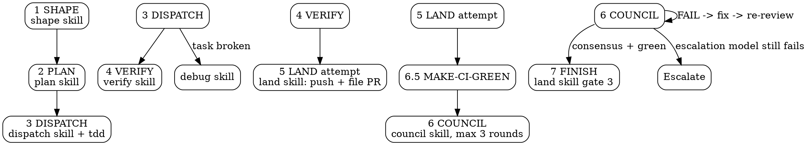

# Oneshot Pipeline

Autonomous end-to-end SDLC: task -> spec -> plan -> implementation -> verification -> PR -> CI watch -> council consensus -> land.

**Core principle:** Full autonomy once started. No pauses between phases. User consulted only at design approval (Gate 1), plan approval (Gate 2), and the final branch decision (Gate 3).

**Auto-approve bypass:** If the initial task description explicitly asks for it ("auto-approve", "skip all approvals", "no approval gates", "full autonomy no questions"), skip all 3 gates. Shape writes `auto-approve: true` plus the quoted trigger phrase on the same header line of the spec BEFORE committing it; oneshot verifies that header line is present and never edits the spec after shape commits it. User instruction at start overrides default gates. Later turns never override it.

**Auto-approve propagation:** when `auto-approve: true` is recorded, the flag travels into the shape and plan dispatch prompts, and those skills must suppress their own approval waits.

**Announce at start:** "Oneshot pipeline starting for: [task description]"

**Visibility:** The whole pipeline runs in the main session. Announce every phase transition. Stream every subagent result back into main as it returns.

**Context hygiene:** Main orchestrates. Main never writes implementation code inline. Per-task and per-round work is dispatched to fresh subagents via the `subagent` tool (some builds register this tool as `task`; use whichever the session exposes). Never delegate a whole phase or the whole pipeline to one subagent.

**Model routing:** Skills never hardcode models. Role rows and fallback ladders live in AGENTS.md ("Model Tank"); every seat agent pins its primary in its agent file. On a usage-limit or 429-style provider error, re-dispatch the same seat agent with an explicit model override along that role's ladder and announce it. Routing-file note: the installed copy of this file is `HARNESS.md`; `<dest>/AGENTS.md` is the user's own file and is never overwritten.

## Pipeline Overview



Run phases sequentially 1 -> 7 in the main session. No skipping. Validate the prior phase artifact exists before entering the next phase.

---

## Phase 1: SHAPE

**Skill:** `shape`
**Output:** `docs/specs/YYYY-MM-DD-<topic>-design.md` (spec)

1. Ensure the working directory (main checkout or git worktree) is on a feature branch (e.g. `feat/<topic>`). If the tree sits on the default branch (`master`/`main`), either switch to a new `feat/<topic>` branch or create and move into a feature worktree (`tools.opencode.worktree_create` + `tools.opencode.session_move`). When already inside a dedicated feature worktree/branch (such as a T3 Code worktree thread), reuse its branch. This is the FIRST step, before the shape skill runs: shape writes and commits the spec, so the feature branch must be active before it runs. All pipeline commits after this point happen on a feature branch.
2. Invoke the `shape` skill via the `skill` tool. Follow its Socratic design checklist: purpose, constraints, success criteria, 2-3 approaches with trade-offs, user-approved design. Shape invokes `domain-modeling` when the design introduces or renames domain concepts, and `codebase-design` when it changes a module interface. The shape skill writes and commits the spec onto that branch.
3. The spec commit is owned by shape (step 2). Oneshot only verifies the spec artifact exists at `docs/specs/YYYY-MM-DD-<topic>-design.md` and proceeds. Do not run `git add` or `git commit` here.
4. Gate 1: user approves the design (skip under bypass; verify the `auto-approve: true` header line shape wrote before committing, do not edit the spec here). One owner for plan handoff: shape returns control to the controller at the end of Phase 1, and the controller will invoke plan exactly once in Phase 2. Shape never invokes plan when running under oneshot, and plan is invoked only by the controller.

---

## Phase 2: PLAN

**Skill:** `plan`
**Output:** `docs/plans/YYYY-MM-DD-<feature>.md` (implementation plan)

1. At the end of Phase 1, shape returns control to the controller, and oneshot will invoke plan exactly once in Phase 2 (shape never invokes plan when running under oneshot, and plan is invoked only by the controller). Invoke the `plan` skill via the `skill` tool. Decompose the spec into bite-size tasks with exact file paths, commands, and commit points. No placeholders.
2. Save to `docs/plans/YYYY-MM-DD-<feature>.md`. Shape owns the spec commit, oneshot owns the plan commit. Commit the plan with this explicit form:
```
if ! git check-ignore -q docs/plans/YYYY-MM-DD-<feature>.md; then
  git add docs/plans/YYYY-MM-DD-<feature>.md
  git commit -m "docs: plan for [topic]"
fi
```
If the path IS ignored, record the local path and never use `git add -f`.
3. Gate 2: user approves the plan (skip under bypass).
4. Execution mode is subagent-driven only. Do not offer inline execution.

---

## Phase 3: DISPATCH

**Skills:** `dispatch` + `tdd`
**Error routing:** `debug`

1. Invoke `dispatch` and `tdd` via the `skill` tool.
2. Work on the active feature branch (in the current checkout or dedicated worktree from Phase 1). Clean `git status` first; create the feature branch or worktree here only if Phase 1 was skipped (e.g. resume into Phase 3).
3. For each plan task, dispatch one of the default implementation seats (`implementer` or `implementer-b`, or `implementer-deep` for tasks flagged complex) via the `subagent` tool with the task brief from `dispatch/implementer-prompt.md`. When a GLOSSARY.md exists, the task brief carries the name of any glossary term the task must honor. The implementer seat follows TDD: failing test -> minimal implementation -> green -> commit (unless Parallel mode: stage only, main commits serially) -> receipt. Seat models and effort levels are pinned in the agent files; fallback rungs live in the AGENTS.md implementation rows.
4. Independent tasks run in parallel as separate fresh subagents (parallel fan-out lives inside `dispatch`).
5. Stream task results to the user as they return (task name, pass/fail, key outputs).
6. Task failure routes to `debug`: root cause first, then re-dispatch (escalating to `implementer-deep` when a bug resists standard fixes). Unfixable after the debug loop: escalate to user with failure context.

Fix-loop caps: at most 3 implementer fix attempts per task, then route to `debug`. Debug gets at most 2 rotations; past that, STOP and escalate to the user with context. Escalation after exhausting caps is an explicit allowed stop point - the no-pause rule never overrides budget exhaustion.

---

## Phase 4: VERIFY

**Skill:** `verify`

1. Invoke `verify` via the `skill` tool.
2. Run test suite, lint, typecheck, build. If no suite exists, run what the project docs define and note it.
3. Cross-check implementation against the spec checklist.
4. Fix failures or route to `debug`. Never proceed on failures.

---

## Phase 5: LAND - push and file the PR

**Skill:** `land`

1. Invoke `land` via the `skill` tool.
2. Push the feature branch, create the PR: body leads with the problem, not the change inventory (`## Summary`, `## Changes`, `## Test plan`). Reference local spec/plan paths when they are gitignored.
3. Save the PR URL.

---

## Phase 6.5: MAKE-CI-GREEN

**Skill:** `make-ci-green`

1. Invoke `make-ci-green` via the `skill` tool (skip if the repo has no CI/review bots; say "no CI to babysit" and move on).
2. Watch checks and bot reviews. Real finding -> fresh fixer subagent -> rerun CI. No new information -> no rerun. No blind loops, no flake chasing.

---

## Phase 6: COUNCIL (consensus, max 3 rounds)

**Skills:** `council`
**Gate to Phase 7:** consensus PASS from at least 2 of 3 reviewers **AND** tests green. Both required.

1. Invoke `council` via the `skill` tool.
2. Dispatch three fresh reviewer subagents on three independent model families (`reviewer-a`, `reviewer-b`, `reviewer-c` agents, seat models pinned in their files). Each assumes the code is broken, hunts for bugs: spec compliance, edges, error handling, security, diff-vs-plan, regressions.
3. Findings merge into one line per item: `path:line: emoji severity: problem. fix.`
4. Round loop (max 3 rounds, never stops mid-loop):
   - FAIL -> dispatch fresh implementation-seat fixer subagents (`implementer` or `implementer-b`, one per problem cluster, max 2 files each; see `AGENTS.md` Review contracts for fixer seat routing) -> push -> re-review next round.
   - PASS + green -> break, proceed to Phase 7.
   - CI freshness gate: if any council fix round pushed commits after the last green `make-ci-green` receipt, re-enter Phase 6.5 on the final HEAD before Phase 7. A stale green receipt never satisfies the gate.
   - If that 6.5 re-entry itself pushes further CI-repair commits, the final HEAD needs one delta council round on the changed files (counted against the 3-round budget); when the round budget is exhausted alongside red CI, STOP and escalate instead of landing unreviewed.
5. Rounds exhausted -> one escalation review with the AGENTS.md escalation row -> still failing -> STOP, escalate to user with round count, findings, test output. Do not proceed.
6. No test suite: see `AGENTS.md` Review contracts for the `no-tests` gate rule. Label a `no-tests` PASS `provisional: no-tests` in the verdict, and have the reviewer flag `no tests` as yellow. Record any `no-tests decision: proceed` in the state artifact; for a standalone council run the state artifact is `$(git rev-parse --git-dir)/info/oneshot-state.md` in the target repo or worktree, created if missing (`mkdir -p "$(git rev-parse --git-dir)/info"`).

**Rules:** Reviewer never fixes, fixer never reviews. Fresh subagents every round. Rounds 1-2 never pause for user input; stream results in passing. Verify every finding against real code before acting.

---

## Phase 7: FINISH

**Skill:** `land` (Gate 3)

1. Verify tests pass on final state (or satisfy the `no-tests` gate rule in `AGENTS.md` Review contracts).
2. Landed options: merge PR and clean up, keep PR open, keep branch, discard. Present options (skip under bypass: default keep PR open).
3. `land` executes the user choice. It reuses the standard flow: create-PR-if-none, merge open PR, checkout default, pull (the "next feature" handoff).
4. Record it with the memory tool: mode "add", content "oneshot completed: [task] on [branch]". Remove the state artifact at the end of the run.

---

## State Artifact

At every phase transition, update `$(git rev-parse --git-dir)/info/oneshot-state.md` (run `mkdir -p "$(git rev-parse --git-dir)/info"` first so both standard checkouts where `.git` is a directory and linked git worktrees where `.git` is a file work cleanly; append or rewrite in place): phase, branch, PR URL, tests status, council round count, standing red findings (one line each). On interrupt, resume from the state artifact plus the spec and plan; the state file is the truth for round counters and standing findings - never re-open a closed round or re-spend a burnt budget. `$(git rev-parse --git-dir)/info/oneshot-state.md` is the only state location: it is machine-local and worktree-local, never committed, never `git add -f`'d, and removed at the end of Phase 7.

## Error Handling

| Symptom | Route | Action |
| --- | --- | --- |
| Task fails during execution | debug | Root cause, fix, retry |
| Unfixable bug | User | Report phase + error + context |
| Council FAIL (rounds 1-2) | council loop | Fix -> re-review automatically |
| Council FAIL (round 3+ or escalation fails) | User | Stop, present findings + test output |
| Spec incomplete | Phase 1 | Fix gaps, re-approve |
| Plan has gaps | Phase 2 | Add missing tasks |
| Reviewer model exhausted | AGENTS.md ladder | Demote role, announce, continue |
| User interrupts | Resume | Restart from state artifact + spec + plan |

## Red Flags - Never

- Skip a phase; proceed without loading the phase skills
- Proceed past Gate 1/2 without approval (unless bypass at start)
- Merge without verification; continue past failures
- Pause, ask, or present options mid-loop after a FAIL round (1-2 in council, all rounds in task loop)
- Delegate the whole pipeline or a whole phase to one subagent
- Run silently: no transition announcements, no streamed results
- Hardcode a model ID; route by role through AGENTS.md
- Run the council on 1 healthy reviewer and call it consensus
- `git add -f` a gitignored path
- Exceed caps: 3 council rounds, silence after escalation

## Key Principles

- **Gated autonomy:** 3 gates only, everything between runs without stopping
- **Artifact-based resume:** state artifact + spec + plan on disk are the truth for resume
- **Context-clean:** implementation only via fresh per-task subagents
- **Visible:** every phase change and subagent result announced in main
- **TDD always:** failing test before production code, per task
- **Consensus over single gatekeeper:** council, independent families, honest degradation
- **Model-agnostic skills:** routing lives only in AGENTS.md
