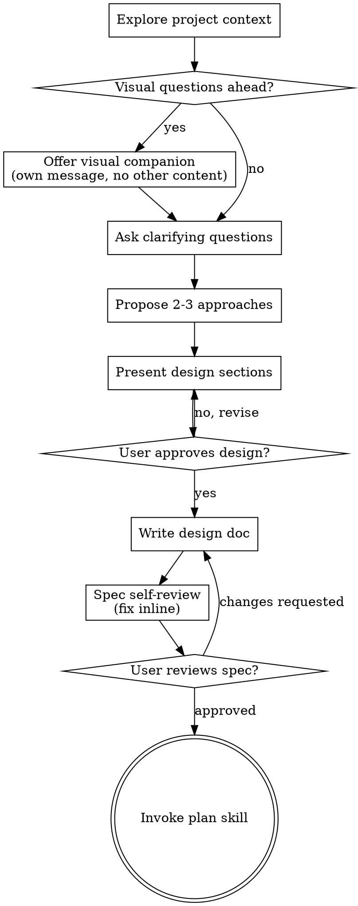

# Shape: Ideas Into Approved Designs

Turn ideas into validated specs through collaborative dialogue. Understand the project, ask questions one at a time, present the design, get approval, then hand off to planning.

<HARD-GATE>
Do NOT invoke any implementation skill, write any code, scaffold any project, or take any implementation action until a design has been presented and the user has approved it. This applies to EVERY project regardless of perceived simplicity.
</HARD-GATE>

## Anti-Pattern: "This Is Too Simple To Need A Design"

Every project runs this process: todo lists, single-function utilities, config changes, all of them. "Simple" projects are where unexamined assumptions cause the most wasted work. The design can be short (a few sentences for truly simple projects), but it MUST be presented and approved.

## Checklist

You MUST create a task for each of these items and complete them in order:

1. **Explore project context** - check files, docs, recent commits
2. **Offer the visual companion** (only if the topic will involve visual questions) - its own message, nothing else in it. See the Visual Companion section below.
3. **Ask clarifying questions** - one at a time: purpose, constraints, success criteria
4. **Propose 2-3 approaches** - with trade-offs and your recommendation
5. **Present the design** - in sections scaled to complexity, user approval after each section
6. **Write the design doc** - save to `docs/specs/YYYY-MM-DD-<topic>-design.md`, commit it
7. **Spec self-review** - inline check for placeholders, contradictions, ambiguity, scope (below)
8. **User reviews the written spec** - wait for explicit approval before proceeding
9. **Transition to implementation** - invoke the plan skill via the skill tool

## Process Flow

**The terminal state is invoking the plan skill via the skill tool.** Do NOT invoke any implementation skill of any kind. plan is the ONLY skill this one hands off to.

## The Process

**Understanding the idea:**

- Survey the project state first: files, docs, recent commits.
- Assess scope before asking detailed questions. A request describing multiple independent subsystems ("a platform with chat, file storage, billing, and analytics") needs decomposition first; flag it immediately instead of refining details.
- Too large for a single spec: help the user decompose. Identify the independent pieces, how they relate, what order to build. Then shape the first sub-project through the normal flow. Each sub-project gets its own spec, then plan, then implementation cycle.
- Properly scoped: one question per message. If a topic needs more exploration, break it into several questions.
- Multiple choice beats open-ended when possible. Open-ended is fine too.
- Target understanding: purpose, constraints, success criteria.

**Exploring approaches:**

- Propose 2-3 different approaches with trade-offs.
- Present options conversationally with your recommendation and reasoning.
- Lead with the recommended option and explain why.

**Presenting the design:**

- Present once confident in what you're building.
- Scale each section to its complexity: a few sentences if straightforward, 200-300 words if nuanced.
- Ask after each section whether it looks right so far.
- Cover: architecture, components, data flow, error handling, testing.
- Be ready to go back and clarify when something doesn't make sense.

**Design for isolation and clarity:**

- Break the system into smaller units: one clear purpose each, well-defined interfaces, independently understandable and testable.
- Every unit must answer: what does it do, how do you use it, what does it depend on?
- Can someone use the unit without reading its internals? Can internals change without breaking consumers? If not, the boundaries need work.
- Smaller, well-bounded units are also easier to work with: reasoning about code held in context at once, and edits are more reliable when files are focused. A file growing large is a signal it does too much.

**Working in existing codebases:**

- Explore the current structure before proposing changes. Follow existing patterns.
- Existing problems that affect this work (a file grown too large, unclear boundaries, tangled responsibilities): fold targeted improvements into the design, the way a good developer improves code they are working in.
- No unrelated refactoring. Stay on what serves the current goal.

## Writing the Design Doc

- Write the validated design (spec) to `docs/specs/YYYY-MM-DD-<topic>-design.md`. User preferences for location override this default.
- Plain, concise prose. Cut every sentence that adds nothing.
- Commit the document to git.

**Spec self-review.** Reread with fresh eyes:

1. **Placeholder scan:** any "TBD", "TODO", incomplete sections, or vague requirements? Fix them.
2. **Internal consistency:** do any sections contradict each other? Does the architecture match the feature descriptions?
3. **Scope check:** focused enough for a single implementation plan, or does it need decomposition?
4. **Ambiguity check:** could any requirement be read two different ways? Pick one and make it explicit.

Fix any issues inline. No re-review cycle: fix and move on.

**User review gate.** After the self-review passes:

> "Spec written and committed to `<path>`. Please review it and tell me if anything should change before I write the implementation plan."

Wait for the response. Changes requested: make them and rerun the self-review. Proceed only after approval.

**Implementation handoff:**

- Invoke the plan skill via the skill tool to create the detailed implementation plan.
- Do NOT invoke anything else. plan is the next step.

## Key Principles

- **One question at a time** - never bundle questions in a message
- **Multiple choice preferred** - easier to answer than open-ended
- **YAGNI ruthlessly** - cut unnecessary features from every design
- **Explore alternatives** - always 2-3 approaches before settling
- **Incremental validation** - present each section, get approval, move on
- **Be flexible** - go back and clarify when something doesn't make sense

## Visual Companion

An optional browser-based companion shows mockups, diagrams, and visual options while shaping. It is a tool, not a mode: accepting it makes it available for questions that benefit from visuals; it does NOT route every question through the browser.

**Offering it:** when upcoming questions look visual (mockups, layouts, diagrams), offer once for consent:

> "Some of this might be easier to show than tell. I can put mockups, diagrams, comparisons, and other visuals in a web browser as we go. The feature is new and token-hungry. Want to try it? (Requires opening a local URL)"

**This offer MUST be its own message.** Only the offer, nothing else: no clarifying questions, no context summary. Wait for the response. Declined: continue text-only.

**Per-question decision,** even after acceptance: **would the user understand this better by seeing it than reading it?**

- **Use the browser** for content that IS visual - mockups, wireframes, layout comparisons, architecture diagrams, side-by-side visual designs
- **Use the terminal** for content that is text - requirements questions, conceptual choices, tradeoff lists, A/B/C/D options, scope decisions

A question about a UI topic is not automatically a visual question. "What does personality mean in this context?" is conceptual: terminal. "Which wizard layout works better?" is visual: browser.

If `visual-companion.md` is present in this skill's directory, read it before driving the browser.
